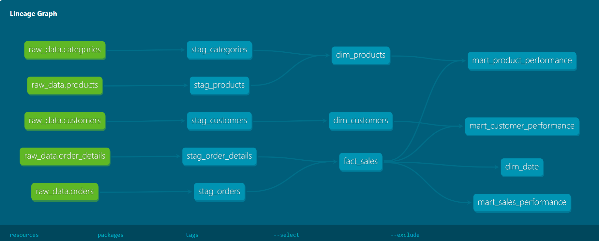
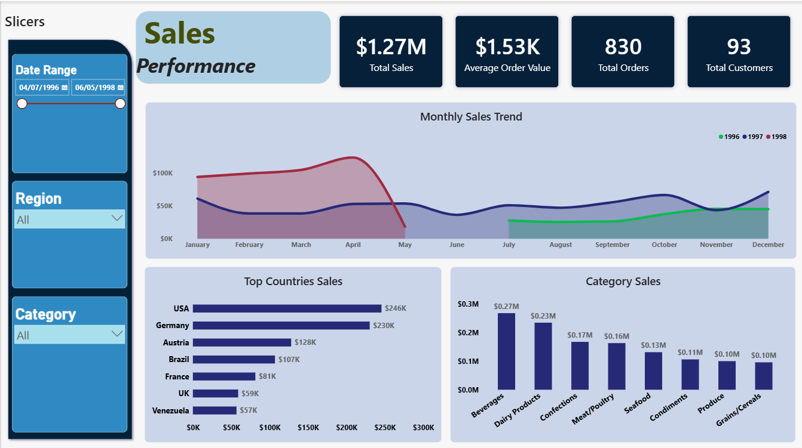
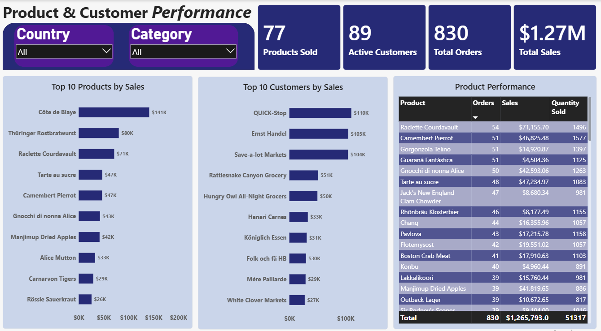

# Sales Analytics Platform

A sales analytics project built with **PostgreSQL, SQL, dbt Core, and Power BI**. The project transforms raw sales data into clean, tested, and analytics-ready models to support business reporting and decision-making.

## Tech Stack

- **PostgreSQL** - Data storage and SQL queries
- **SQL** - Data inspection and transformation
- **dbt Core** - Data modeling, testing, and documentation
- **Power BI** - Data visualization and reporting

## Project Architecture

The project follows a two-layer dbt architecture:

**Raw Data → Staging → Marts → Power BI**

- **Staging:** Prepares and cleans raw source data.
- **Marts:** Builds fact, dimension, and reporting models.
- **Power BI:** Uses the reporting models to present business insights.


### dbt Lineage Graph

The lineage graph shows how data moves from the raw source tables through staging and marts models.



## Power BI Dashboard

The report contains two pages covering sales, product, and customer performance.

### 1. Sales Performance

Provides an overview of sales results, including total sales, total orders, average order value, monthly sales trends, sales by country, and sales by category.



### 2. Product & Customer Performance

Highlights product and customer contributions to sales through top-performing products, top customers, and a product performance matrix.



## Project Highlights


| Area                 | Result |
| -------------------- | ------ |
| Raw source tables    | 11     |
| Raw records          | 3,311  |
| dbt staging models   | 5      |
| dbt core models      | 4      |
| dbt reporting models | 3      |
| Total dbt models     | 12     |
| dbt tests passed     | 49/49  |


### Data Quality and Validation

- Inspected source tables, row counts, missing values, duplicates, and selected table relationships using SQL.
- Built dbt tests to check data quality.
- Compared sales totals and other key metrics between fact and reporting models.
- Checked Power BI KPI values against dbt reporting models.


## Repository Structure

```
sales_analytics_dbt/
│
├── docs/
│   ├── data_inspection/
│   └── images/
│
├── models/
│   ├── staging/
│   └── marts/
│       ├── core/
│       └── reporting/
│
├── power_BI/
│   └── northwind Analysis.pbix
│
├── analyses/
├── macros/
├── seeds/
├── snapshots/
├── tests/
│
├── .gitignore
├── dbt_project.yml
└── README.md
```


## Running the dbt Project

Requirements: PostgreSQL, Python, dbt Core, and the dbt-postgres adapter.

Configure a dbt profile named `sales_analytics_dbt` to connect to your PostgreSQL database. The source data should be available in the `raw_data` schema.

Run these commands from the project directory:

```
# Check the database connection
dbt debug

# Build all models
dbt run

# Run data quality tests
dbt test

# Generate dbt documentation
dbt docs generate

# View dbt documentation
dbt docs serve
```


## Scope and Limitations

- The analysis focuses on sales, product, and customer performance.
- Profit analysis was not included because reliable product cost data was unavailable.
- One test order (`OrderID 11078`) has no matching order details and is excluded from sales analysis.
- The customer dimension contains 93 customers, while 89 customers have sales records.

---

**Project:** Sales Analytics Platform  
**Tools:** PostgreSQL | SQL | dbt Core | Power BI